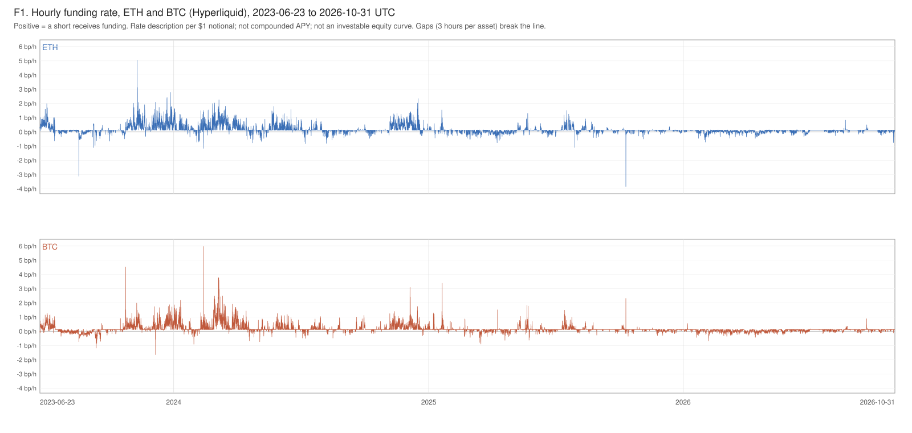
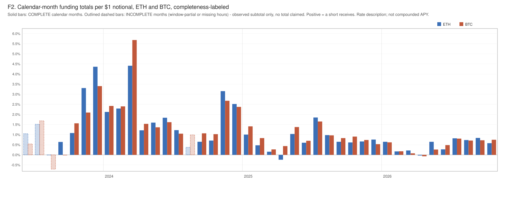

# Study 0 — ETH/BTC Perpetual Funding on Hyperliquid: A Descriptive Foundation

**OpenBasis Study 0.** A descriptive study of the hourly funding rate paid on ETH and BTC perpetual contracts on Hyperliquid over 2023-06-23 to 2026-10-31 (UTC), its variation and negative periods, reference cost and reserve drag, and the design implications. The study design (`DESIGN.md`) was sealed as this repository's first commit before any result was computed; every number below reproduces deterministically from the frozen raw inputs. This study ends at its design conclusion.

## 1. Summary

- Over 29,445 observed hours per asset (of 29,448 in the window), cumulative funding received by a continuously held short of $1 notional was **$0.4747 (ETH)** and **$0.4792 (BTC)** — arithmetic annualized rates of **14.12%** and **14.26%** per year. These are rate descriptions, not compounded APY and not an investable equity curve.
- The level is front-loaded: the complete calendar year 2025 totals **8.53% (ETH)** and **10.63% (BTC)**, and the Jan–Oct 2026 observed subtotal is **4.89% (ETH)** and **4.53% (BTC)** — well below the 2023–2024 pace (2024 subtotals, one hour short of complete: 22.10% and 24.20%).
- Funding is positive in **86.5% (ETH)** / **87.6% (BTC)** of observed hours and negative in **13.5% / 12.4%**; the median hour sits exactly at the venue's baseline rate (0.00125% per hour). Negative stretches are routine: **1,018 (ETH)** and **848 (BTC)** completed negative runs, median 2 hours, 95th percentile 13–17 hours, longest **92 h (ETH)** and **118 h (BTC)**; the single worst completed run cost a $1 short **−34.3 bp (ETH)** / **−28.0 bp (BTC)** in cumulative funding.
- Reference round-trip cost is fixed by the sealed worksheet at **29 bps** per paired notional (modeled input, not an executable quote); annualized reference drag is **352.83 / 117.61 / 29.00 bps** at 30/90/365-day holding periods, doubling to **705.67 / 235.22 / 58.00 bps** in the sole sensitivity.
- A USDC reserve on Aave v3 (Arbitrum) accrued, on the modeled hourly approximation of aggregator-reported base rates, an annualized mean of **4.54% (USDC.e)** / **4.87% (native USDC)** on each segment's covered hours.
- Reference-market risk: the worst observed 24-hour moves were **−23.8% (ETH)** and **−18.4% (BTC)**, both ending 2024-08-05T12:00Z; the worst 1-hour ETH move was **−11.6%** (2025-02-03T01:00Z). These are observations of Coinbase hourly closes, not liquidation or margin tests.

## 2. What this study is, and is not

Study 0 measures and describes. It runs no strategy backtest, selects no operating policy, sets no return hurdle, and certifies no net return — no net-APY figure appears anywhere, by design. A correctly measured small, negative, or inconclusive opportunity was an acceptable outcome under the sealed acceptance criteria. OpenBasis has prior internal research involving overlapping data sources; Study 0's raw inputs were nonetheless retrieved fresh on 2026-11-01, its design was sealed by commit before any Study 0 result existed, and the full prior-exposure disclosure is in the sealed `DESIGN.md`.

## 3. Data

| Series | Source | Observed / expected hours | Notes |
|---|---|---|---|
| ETH, BTC hourly funding | Hyperliquid public API (`fundingHistory`) | 29,445 / 29,448 each | 3 missing hours per asset (2023-07-02 19:00, 2023-08-23 19:00, 2024-08-15 12:00 UTC); zero conflicting records |
| ETH-USD, BTC-USD hourly closes | Coinbase Exchange candles | 29,438 / 29,448 each | two 5-hour missing-candle gaps (2025-10-25, 2026-05-08; absent candles at source, cause not established); reference marks only |
| Aave v3 Arbitrum USDC supply rate | DefiLlama daily pool series (aggregator evidence, by sealed exception) | USDC.e 28,304 / 29,448; native 29,232 / 29,304 derived hours | two separate dated segments, never stitched; daily snapshots expanded to hours under a sealed bounded rule — modeled approximation, not observed hourly returns |

Conventions (sealed before computation): UTC hourly buckets labeled by bucket start; a funding settlement maps to the hour it compensates (the bucket starting one hour before its settlement hour); positive funding means **a short receives**; no zero-fill, interpolation, or window selection anywhere — the single sealed exception is the reserve series' bounded daily-snapshot rule (each snapshot applies only after its timestamp, for at most 24 hours, never past the next snapshot; missing days remain gaps). Quantiles use linear interpolation. Sums use exact decimal arithmetic. Calendar periods are labeled COMPLETE only when every expected hour is observed; otherwise only the observed subtotal is shown, and all periods appear, including partial boundary periods. Full provenance — endpoints, retrieval times, SHA256 hashes of all 349 raw files, duplicate and gap censuses — is pinned in the repository (`data/MANIFEST.json`, `data/COVERAGE.json`) and summarized in Appendix A.

## 4. Funding (Figures F1, F2; Tables T2–T5)

Per $1 of constantly held short notional, over each asset's 29,445 observed hours:

| | ETH | BTC |
|---|---|---|
| Cumulative funding received | $0.4746588125 | $0.4791731877 |
| Arithmetic annualized rate | 14.12%/yr | 14.26%/yr |
| Mean hourly rate | 0.161 bp/h | 0.163 bp/h |
| Median hourly rate | 0.125 bp/h (venue baseline) | 0.125 bp/h |
| p5 / p95 hourly | −0.111 / +0.672 bp/h | −0.103 / +0.648 bp/h |
| Min / max hourly | −3.86 / +5.06 bp/h | −1.66 / +5.98 bp/h |
| Hours positive / zero / negative | 86.53% / 0.00% / 13.47% | 87.56% / 0.00% / 12.44% |

The annualized figures are arithmetic rate descriptions (8760 × sum ÷ observed hours). The time profile matters more than the full-window average: 2023 H2 and 2024 carried the bulk of the funding (2024 observed subtotals 22.10% ETH / 24.20% BTC, each one missing hour short of COMPLETE), while 2025 — the only COMPLETE calendar year — totals 8.53% / 10.63%, and Jan–Oct 2026 totals 4.89% / 4.53%. Individual months go negative even within positive years: ETH April 2025 (−0.24%) and April 2026 (−0.03%); BTC September 2023 (−0.02%) and April 2026 (−0.07%); August 2023's observed subtotals were negative for both assets (−0.01% ETH, −0.71% BTC; INCOMPLETE, one missing hour). Full monthly and per-run detail is in the committed appendix tables (T3, T4, T7).

## 5. Negative funding periods (Table T6, T7)

A negative run is a maximal stretch of consecutive observed hours with strictly negative funding; zero, positive, or missing hours end it, and runs touching the window edge or a data gap are reported separately as censored, never extrapolated.

| | ETH | BTC |
|---|---|---|
| Completed runs | 1,018 | 848 |
| Censored runs (listed separately) | 1 | 2 |
| Median / p95 / max duration | 2 h / 13 h / 92 h | 2 h / 16.65 h / 118 h |
| Median run cost per $1 | −0.11 bp | −0.09 bp |
| Worst completed run per $1 | −34.28 bp | −27.99 bp |

Negative funding is not an anomaly of this market; it recurs on the order of a thousand distinct episodes per asset across the window, mostly hours long, occasionally days long. The longest observed stretches (roughly four and five days) and the worst cumulative run costs are facts any always-exposed design must carry without assuming an exit.

## 6. Spot reference-market moves (Table T8)

Simple returns of Coinbase hourly closes, computed only where every hourly close in the span exists:

| | k = 1 h | k = 24 h |
|---|---|---|
| ETH p1 / p99 | −1.95% / +1.89% | −8.60% / +9.30% |
| ETH worst down / up | −11.57% (2025-02-03 01:00Z) / +9.59% (2025-03-02 16:00Z) | −23.76% (2024-08-05 12:00Z) / +24.68% (2025-05-09 08:00Z) |
| BTC p1 / p99 | −1.47% / +1.43% | −6.14% / +6.86% |
| BTC worst down / up | −4.90% (2025-03-07 00:00Z) / +5.73% (2023-08-29 14:00Z) | −18.40% (2024-08-05 12:00Z) / +13.68% (2023-10-24 02:00Z) |

These are reference-market observations. They are not liquidation tests, margin certifications, or statements about any venue's executable prices.

## 7. Cost worksheet (Table T9)

All entries are **modeled inputs fixed in the sealed design — not empirical findings, not current executable quotes**. One-way perp fee 4.5 bps; one-way off-venue spot fee-plus-impact 10 bps (impact inside the 10 bps, counted once); one entry plus one exit = **29 bps per paired notional**.

| Holding period D | Annualized reference drag (base) | Doubled (sole sensitivity) |
|---|---|---|
| 30 days | 352.83 bps/yr | 705.67 bps/yr |
| 90 days | 117.61 bps/yr | 235.22 bps/yr |
| 365 days | 29.00 bps/yr | 58.00 bps/yr |

Gas appears only as an illustration at $0.50 per assumed leg, never as a measured route cost. The following remain **unpriced and visible** — neither zero nor silently included: perp market impact, gas beyond the illustration, transfers, top-ups, settlement, borrow/custody, opportunity cost. This worksheet produces no trade-size grid, no optimal holding period, no total-cost certification, and no net-APY claim.

## 8. Reserve worksheet and capital bridge (Tables T10, T11)

The reserve series is **aggregator evidence** (DefiLlama daily pool data, used under an explicit sealed exception) for the Aave v3 Arbitrum USDC base supply rate, which the pinned source maps as an annual percentage rate; reward components are excluded and said so. Daily snapshots are expanded to hours only under the sealed bounded rule, so the hourly series is a **modeled approximation, not observed hourly returns**.

| Segment | Derived hours (of expected) | Sum accrual per $1 | Annualized mean |
|---|---|---|---|
| USDC.e (bridged) | 28,304 of 29,448 (1,144 gap hours) | $0.1465 | 4.54%/yr |
| Native USDC (from 2023-06-29) | 29,232 of 29,304 (72 gap hours) | $0.1625 | 4.87%/yr |

The capital bridge is **symbolic only**: with N = matched short notional, R = reserve, C = total capital — funding contribution (N/C)·Σfunding, reserve contribution (R/C)·Σaccrual, cost contribution cost-dollars/C. Study 0 selects no N/C or R/C. A yield-bearing reserve is not risk-free cash: whether its return is a gain or a drag depends on an opportunity-cost comparator this study does not choose. Reserve capital dilutes funding capture per unit of capital and is subject to delayed availability. Funding sums and reserve accruals use unlike conventions and are never added together here.

## 9. Limitations

- Coinbase closes are reference marks from one venue; nothing here establishes executable prices or venue-level marks.
- The reserve series is third-party aggregator data at daily resolution; its hourly form is a sealed modeled approximation with disclosed gaps (notably 1,144 derived gap hours on the USDC.e segment), and the two token segments are reported separately.
- The cost worksheet is a fixed reference model with one sensitivity; the unpriced register (§7) is real money that this study leaves unmeasured.
- Small gaps exist in every series (3 funding hours per asset; two 5-hour missing-candle gaps in spot); all statistics exclude, and none extrapolate across, missing hours. The spot gaps are absent candles at source; the pinned evidence does not establish their cause.
- Arithmetic annualized rates describe the past window; nothing in this study is a forecast, and the within-window compression (§4) shows how differently sub-periods behave.
- Reproducibility is contracted on the pinned study environment recorded in the repository, not on arbitrary platforms.

## 10. Design implications (the design conclusion)

1. **Positive-mean, regime-varying funding.** Both assets earned a short roughly 14%/yr arithmetic over the full window, but the recent regime is materially thinner (8.5–10.6% in 2025; ~4.5–4.9% observed over ten months of 2026). A design premised on early-window levels would overstate the opportunity; any assessment must weigh the compressed recent regime, and this study makes no forecast of either.
2. **Negative funding must be carried, not dodged.** With ~12–13% negative hours arriving in over eight hundred completed runs per asset — p95 runs under a day but maxima of 4–5 days and worst run costs of 28–34 bp per $1 — an always-exposed design needs the capital and nerve to sit through multi-day negative stretches. Study 0 simulated no funding gate and endorses none.
3. **Turnover is the first-order cost lever within this worksheet.** At the sealed reference constants, monthly round trips imply 352.83 bps/yr of drag (705.67 doubled) — the same order as the complete-2025 funding totals — while annual turnover implies 29–58 bps/yr. No net return is computed; the juxtaposition simply shows that holding-period discipline dominates the modeled cost side, before the unpriced register is even touched.
4. **Reserve yield is conditional.** The reserve segments accrued a modeled ~4.5–4.9%/yr, each on its own covered hours (aggregator evidence under the sealed bounded rule). Study 0 computes no comparison between this figure and funding levels: the series have different coverages, and no common-timestamp cross-series comparison was performed. The reserve return buys exposure dilution and delayed availability, and judging it a gain or a drag requires an opportunity-cost comparator left unchosen here.
5. **Tail moves set the risk frame.** Reference-market moves of −18% to −24% in 24 hours (and −11.6% in one ETH hour) occurred inside this window. Any margined short structure must be designed against moves at least this size; this study provides the observations, not the margin test.
6. **Data gaps are a design input.** Every series has holes — 3 funding hours, two 5-hour missing-candle gaps in spot, and over a thousand derived gap hours on one reserve segment. A design consuming these feeds needs explicit staleness and missing-data handling rather than silent carry.

Study 0 ends here, at the design conclusion.

## 11. Audit Process

Study 0 is audited against nine sealed acceptance criteria, S1–S9 — seal integrity and truthful prior-exposure disclosure (S1); dated provenance, hashes, units and coverage (S2); completeness and correctness of the specified funding, negative-run and spot results (S3); cost and reserve worksheets that reconcile and claim no investable net (S4); design conclusions that follow from the evidence with adverse results visible (S5); consistency with the prior sealed internal baseline via an internal clause-level matrix (S6); public artifacts that stop at the design conclusion with no anachronism and no false chronology (S7); a complete retained audit trail (S8); and full reproducibility with source-to-output links and recorded hashes (S9). The protocol allows at most five audit rounds; only the auditor's written verdict ends a round, and PASS requires all nine criteria with no open blocking or major finding.

**Audit record.** Two written audit rounds occurred; two written verdicts exist. **Round 1: FAIL** (verdict 1 of at most 5) — one BLOCKER, two MAJOR findings, one MINOR finding; S1, S3, S4, S6 and S9 passed, S2, S5 and S8 were partial, S7 failed. The auditor's independent recomputation from the pinned raw files matched every submitted numerical result (331 of 331 value comparisons; zero hash mismatches across the 349 pinned data files); no numerical, sign, unit, cost or reproducibility error was found. The substantive findings and what was done:

- **R1-01 (BLOCKER, S7 — publication boundary).** The report's scope statement included a negated reference to an artifact class that the publication boundary keeps out of public text, and this section promised a later update of itself; the boundary bars both forms. Both sentences were removed in Round 2. The scope statement remains truthful without the barred reference, and this section now records actual outcomes only.
- **R1-02 (MAJOR, S2/S5 — cross-series comparison without common coverage).** A design-implication sentence called the reserve yield significant next to recent funding levels, although the reserve and funding series have different coverages and no sealed exact-timestamp intersection was computed or disclosed. The comparison was removed in Round 2; the per-segment reserve description and the symbolic capital bridge stand unchanged.
- **R1-03 (MAJOR, S8 — audit account).** This section previously said no verdict existed and deferred the record to a later update. It was replaced in Round 2 with the factual record above.
- **R1-04 (MINOR, S2 — unsupported cause label).** Two five-hour runs of absent Coinbase candles were labeled "outages"; the pinned evidence establishes absent candles, not their cause. Round 2 relabels them missing-candle gaps everywhere. No number changed.

**Round 2: PASS** (verdict 2 of at most 5) — the written Round 2 verdict passes all nine criteria S1–S9, closes findings R1-01 through R1-04, and leaves no open blocking or major finding. The Round 1 FAIL and its findings remain part of the retained record. The full findings and verdicts of both rounds are retained verbatim in the repository's audit trail (`audit/findings_round1.md`, `audit/verdict_round1.md`, `audit/findings_round2.md`, `audit/verdict_round2.md`). The builder and auditor are working roles operating on the same repository; persona titles describe working roles rather than individual credentials.

---

## Appendix A — Data and assumption register

**Sources and retrieval.** All raw inputs were retrieved 2026-11-01 19:13–19:27 UTC and pinned verbatim: Hyperliquid `POST /info` `fundingHistory` for ETH and BTC (hourly settlements 2023-06-23 00:00 through 2026-11-01 00:00 UTC inclusive — the final settlement is boundary evidence for the last window hour, not an extension); Coinbase Exchange `GET /products/{ETH-USD,BTC-USD}/candles?granularity=3600` (candle time = bucket start, UTC; no-trade buckets are missing, never filled); DefiLlama `yields.llama.fi/chart/{pool}` for Aave v3 Arbitrum USDC — native pool `d9fa8e14-0447-4207-9ae8-7810199dfa1f` (token `0xaf88…5831`) and USDC.e pool `7aab7b0f-01c1-4467-bc0d-77826d870f19` (token `0xFF97…5CC8`) — plus the pinned DefiLlama yield-server source establishing that the `apyBase` field carries the protocol's annualized linear-accrual rate in percent, unchanged across pinned adapter versions spanning the window. Per-file request parameters, retrieval timestamps and SHA256 hashes: `data/MANIFEST.json` (349 files); coverage, duplicate and gap censuses: `data/COVERAGE.json`.

**Units and sign.** Funding is the hourly applied rate as a fraction of notional (modal value exactly 0.0000125 = the venue's 0.00125%/h baseline; settlements hourly). Positive = a short receives. Funding values are ingested as exact decimal strings; sums and calendar totals are exact; distribution statistics use float64; quantiles use linear interpolation. 1 bp = 1e-4.

**Assumptions (all disclosed, none empirical):** perp fee 4.5 bps and spot fee-plus-impact 10 bps one-way (reference constants fixed in the sealed design); gas $0.50/leg illustration; the reserve hourly series per the sealed bounded snapshot rule (modeled approximation; base rate only; segments separate); USD accounting with Coinbase closes as reference marks only. Unpriced register per §7.

**Reproducibility.** Every number and deterministic table/figure in this study rebuilds from the frozen raw inputs with the committed analysis scripts on the pinned study environment; an independent recomputation of the headline funding sums and the cost worksheet, a clean-directory rebuild (byte-identical outputs), and synthetic-fixture checks of signs, mapping, censoring and the snapshot rule are part of the committed run records (`study/run_logs/`, `study/host_receipts/`).

## Appendix B — Detailed tables

Committed with this study: T1 series inventory (`reports/tables/T01_series_inventory.md`); T2 funding statistics; T3/T4 calendar-month funding totals for ETH/BTC (every month shown with completeness labels); T5 calendar-year totals; T6 negative-run summaries; T7 full per-run listing (1,869 runs including censored); T8 spot risk descriptors; T9 cost worksheet; T10 reserve segment summaries; T11 the symbolic capital bridge.
